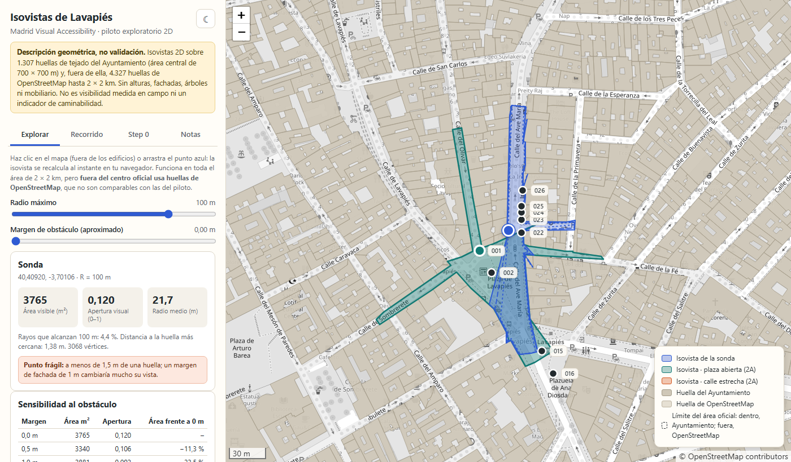

<div align="center">

# Madrid Isovist Demo

**Isovistas 2D recalculadas en el navegador sobre huellas de edificios de Lavapiés (Madrid)**

[](https://github.com/soroushkarahrodi79-oss/madrid-isovist-demo/actions/workflows/check.yml)
[](https://soroushkarahrodi79-oss.github.io/madrid-isovist-demo/)
[](LICENSE)
[](docs/DATOS_Y_LICENCIAS.md)
[-yellow)](docs/LIMITES_Y_FIDELIDAD.md)

[**Abrir la demo**](https://soroushkarahrodi79-oss.github.io/madrid-isovist-demo/) ·
[Qué se puede hacer](#qué-se-puede-hacer) ·
[Resultado del Step 0](#resultado-del-step-0) ·
[Límites](docs/LIMITES_Y_FIDELIDAD.md) ·
[Datos y licencias](docs/DATOS_Y_LICENCIAS.md) ·
[Cómo citar](#cómo-citar)

<a href="https://soroushkarahrodi79-oss.github.io/madrid-isovist-demo/">

</a>

</div>

> **In English:** an interactive Leaflet map that recomputes 2D isovists in the browser from building footprints in Lavapiés, Madrid, with a free probe, an animated walk, obstacle-margin sensitivity and the results of a pre-registered redundancy screen (Step 0, mixed verdict). It is a geometric description, not field-validated visibility and not a walkability index. The interface is in Spanish.

## Resultado del Step 0

Un cribado de redundancia con **regla de parada fijada y registrada con hash antes de calcular**: ¿una isovista 2D de huellas añade algo a la densidad edificada y a la red de calles?

| Medida | R² validado | Umbral | Resultado |
|---|---|---|---|
| Radio medio | **0,937** (IC 95 %: 0,904–0,951) | 0,85 | alcanzado |
| Apertura | **0,833** (IC 95 %: 0,762–0,874) | 0,85 | no alcanzado |
| **Veredicto** | **MIXTO** | | estable en 30 particiones repetidas |

Lectura honesta: con huellas 2D, la isovista aporta poco más allá de lo que ya dicen las huellas. Los controles y las isovistas salen de las mismas huellas, así que esto **no** dice que la visibilidad no importe, y no se probó ningún resultado peatonal. Más detalle en [límites y estado del piloto](docs/LIMITES_Y_FIDELIDAD.md).

## Qué se puede hacer

| Pestaña | Qué ofrece |
|---|---|
| **Explorar** | Haz clic o arrastra el punto azul: la isovista se recalcula en tu navegador (unos 10 a 25 ms). Radio de 30 a 120 m, **sensibilidad al obstáculo** con margen 0, 0,5 y 1 m (tabla y contornos), puntos A y B para comparar, enlace con el estado, CSV de los puntos y **descarga PNG** de la vista. |
| **Recorrido** | Un observador camina de la calle de Valencia a Ave María y la isovista se recalcula en cada paso, con el perfil del área visible. |
| **Step 0** | Los 250 puntos del cribado coloreados por radio medio, apertura o residuo; al hacer clic se ve lo observado, lo predicho por los controles y el residuo. |
| **Notas** | Cómo leer los resultados y sus límites. |

Además: nueve observadores del piloto (fase 2A) con sus polígonos almacenados, un contorno que marca dónde acaban las huellas oficiales y empiezan las de OpenStreetMap, tema claro y oscuro, vista para móvil y teclado.

## Qué es y qué no es

| Es | No es |
|---|---|
| Una **descripción geométrica**: 360 rayos más uno por vértice, obstáculos = huellas de tejado, 100 m por defecto | Visibilidad validada en campo ni un indicador de caminabilidad |
| Un cálculo que coincide con Python: área hasta un 0,5 % de diferencia (`tests/test_isovist.js`) | Inferencia sobre población: los nueve observadores se colocaron a mano |
| Fiel a las huellas del Ayuntamiento en el centro (700 × 700 m) | Comparable fuera del centro: allí se usan huellas de OpenStreetMap, con otra definición |

Sin alturas, fachadas, árboles ni mobiliario: la visibilidad real en calle es menor. Detalles, fidelidad del margen de obstáculo y estado del piloto en [docs/LIMITES_Y_FIDELIDAD.md](docs/LIMITES_Y_FIDELIDAD.md).

## Arranque rápido

```bash
python -I -X utf8 build.py            # regenera index.html desde src/ y data/
python -I -X utf8 build.py --check    # comprueba que index.html corresponde a las fuentes
node tests/test_isovist.js            # compara con los resultados de Python (PASS o FAIL)
python -m http.server 8765            # servir en local (también funciona abriendo index.html)
```

No edites `index.html` a mano: se sobrescribe al construir.

<details>
<summary><b>Estructura del repositorio</b></summary>

| Ruta | Contenido |
|---|---|
| `index.html` | Página autónoma generada; es lo que publica GitHub Pages |
| `src/template.html`, `src/style.css`, `src/app.js` | Interfaz |
| `src/isovist.js` | Cálculo de isovistas (sin dependencias, también se usa desde Node) |
| `src/vendor/` | Leaflet 1.9.4 (BSD-2-Clause) |
| `data/buildings.json`, `data/observers.json`, `data/step0_points.json` | Huellas del Ayuntamiento, observadores de la fase 2A y los 250 puntos del Step 0 |
| `data/buildings_osm.json`, `data/osm_meta.json` | Huellas de OpenStreetMap fuera del área oficial y su procedencia |
| `tools/fetch_osm_buildings.py` | Descarga y prepara las huellas de OpenStreetMap (una petición a Overpass) |
| `tests/test_isovist.js` | Compara el cálculo con Python |
| `docs/` | Límites, datos y licencias, rendimiento y pendientes |
| `build.py` | Genera `index.html` |

</details>

## Datos y licencias

- **Código:** [MIT](LICENSE).
- **Huellas de edificios:** Origen de los datos: Ayuntamiento de Madrid, bajo sus [condiciones generales de reutilización](https://datos.madrid.es/pages/condiciones-generales-ayuntamiento-de-madrid). Esta demo **no está respaldada por el Ayuntamiento de Madrid**.
- **OpenStreetMap** (huellas fuera del centro, puntos de interés y mapa base): © OpenStreetMap contributors, [ODbL](https://opendatacommons.org/licenses/odbl/1-0/).
- **Ejes de calle de EMT:** no se han encontrado condiciones de reutilización publicadas; este repositorio no incluye sus geometrías.

Detalle completo, procedencia y limitaciones en [docs/DATOS_Y_LICENCIAS.md](docs/DATOS_Y_LICENCIAS.md).

## Cómo citar

Si usas este software, GitHub ofrece el botón **«Cite this repository»** (archivo [`CITATION.cff`](CITATION.cff)). Los datos tienen sus propias condiciones, descritas arriba.

## Pendiente

Medir los fps en un portátil y un móvil reales, sustituir las huellas de OpenStreetMap por huellas oficiales si se consigue un archivo mayor y confirmar las condiciones de la capa de EMT. Ver [docs/RENDIMIENTO_Y_PENDIENTES.md](docs/RENDIMIENTO_Y_PENDIENTES.md).
